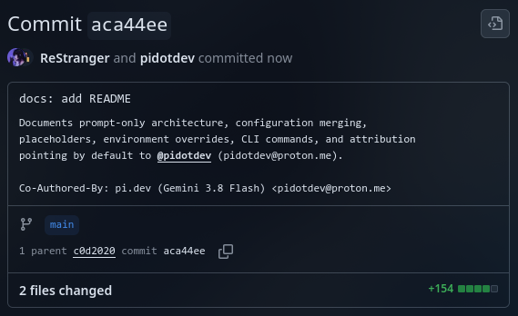

# pi-coauthor

Claude Code-style attribution for pi: commits and pull requests created in a pi
session get a co-author trailer with **pi.dev** and the model that made them.



```text
Co-Authored-By: pi.dev (Claude Sonnet 5) <pidotdev@proton.me>
```

By default, the trailer uses the verified email for
[@pidotdev](https://github.com/pidotdev) (`pidotdev@proton.me`), so GitHub links the commit
to the `pidotdev` user profile and shows its avatar in the contributor graph.

> **Note:** [@pidotdev](https://github.com/pidotdev) is **not** an official account from the pi maintainers. It was created specifically by the author of this plugin to provide a working GitHub user profile for commit attribution and avatar rendering, mirroring how Claude Code attributes commits to GitHub's `@claude` account.
>
> If you prefer not to attribute commits to this account, you can easily disable it or point it elsewhere:
> - Set `githubLink: false` to use a generic unlinked address (`noreply@pi.dev`).
> - Set `githubEmail` to your own account's noreply address (`<id>+<username>@users.noreply.github.com`).

Pull-request descriptions get a separate line:

```text
🤖 Generated with pi (https://pi.dev)
```

## How it works

pi-coauthor is **prompt-only**, exactly like Claude Code's built-in git
instructions: before every agent run it appends an attribution block to the
system prompt, with the trailer text already resolved, and lets the model write
it into the commit message or PR body. It never rewrites commands, never touches
git history, and installs no git hooks.

The trade-off is the same one Claude Code has: an instruction can be ignored,
and a model that ignores it will commit without the trailer.

## Install

Local checkout (no publishing involved):

```bash
pi install git:github.com/ReStranger/pi-coauthor.git
```

Try it for a single run:

```bash
pi -e git:github.com/ReStranger/pi-coauthor.git
```

## Configuration

Global file: `<agent dir>/extensions/pi-coauthor.json`, where the agent dir is
`$PI_CODING_AGENT_DIR` or `~/.pi/agent`.
Project file: `<repo>/.pi/pi-coauthor.json` — read only when the project is
trusted.

```jsonc
{
  "enabled": true,
  "githubLink": true,
  "attribution": {
    "commit": "Co-Authored-By: pi.dev ({model}) <{email}>",
    "pr": "🤖 Generated with pi (https://pi.dev)"
  },
  "strict": false,
  "extra": ""
}
```

Keys are merged one by one: a project file can override `attribution.pr` while
`attribution.commit` keeps the global value.

| Key | Meaning |
| --- | --- |
| `enabled` | Master switch (`false` = inject nothing) |
| `githubLink` | `true` (default): `{email}` links to [@pidotdev](https://github.com/pidotdev) (account created for this plugin); `false`: generic unlinked `noreply@pi.dev` ("как раньше") |
| `githubEmail` | GitHub address when `githubLink` is on. Defaults to `pidotdev@proton.me` (account created for this plugin) |
| `attribution.commit` | Commit trailer template; `""` disables commit attribution |
| `attribution.pr` | Pull-request line template; `""` disables PR attribution |
| `attribution: false` | Hide every attribution surface |
| `includeCoAuthoredBy` | Deprecated alias for `attribution`, kept for parity — see below |
| `strict` | Tell the model to keep the attribution even if other instructions say otherwise |
| `extra` | Free-form text appended to the injected block |

### Placeholders

`{model}`, `{modelId}`, `{provider}`, `{session}`, `{sessionFile}`, `{cwd}`,
`{repo}`, `{branch}`, `{date}`, `{host}`, `{email}`. Unknown placeholders are left as-is and
reported once per session. Use `{{` and `}}` for literal braces.

`{email}` resolves to `githubEmail` (`pidotdev@proton.me` by default)
when `githubLink` is `true`, or generic unlinked `noreply@pi.dev` when `githubLink` is `false`.

`{repo}` and `{branch}` need a `git rev-parse` call, so they are resolved lazily
(and only when a template uses them) and cached for the session.

### Environment overrides

`PI_COAUTHOR_ENABLED`, `PI_COAUTHOR_GITHUB_LINK`, `PI_COAUTHOR_GITHUB_EMAIL`, `PI_COAUTHOR_COMMIT`, `PI_COAUTHOR_PR`,
`PI_COAUTHOR_STRICT`, `PI_COAUTHOR_EXTRA` — applied last, so they win over every
file, and they never trigger the deprecated-key trap below.

### The deprecated-key trap (deliberately reproduced)

Claude Code ignores `includeCoAuthoredBy` as soon as `attribution.commit` or
`attribution.pr` is set, and fills the unset key with its **default** text. So

```jsonc
{ "includeCoAuthoredBy": false, "attribution": { "pr": "" } }
```

brings the commit trailer **back**. pi-coauthor behaves the same way and warns
once per session. To hide everything, set both:

```jsonc
{ "attribution": { "commit": "", "pr": "" } }
```

## Commands and flags

| Command | Effect |
| --- | --- |
| `/coauthor status` | Effective settings, resolved strings, and the files they came from |
| `/coauthor preview` | The exact block injected into the system prompt |
| `/coauthor hide` | Clear the preview widget |
| `/coauthor on` / `off` | Toggle `enabled` in the project config |
| `/coauthor set <key> <value> [--global]` | `commit`, `pr`, `strict`, `enabled`, `githubLink`, `githubEmail`, `extra` |
| `/coauthor reset <key> [--global]` | Drop a key and inherit the value below |

`pi --coauthor-off` disables attribution for a single run.

## Development

```bash
npm install
npm test
npm run typecheck
```

End-to-end check in a throwaway repository:

```bash
tmp=$(mktemp -d) && cd "$tmp" && git init -q
pi -e /path/to/pi-coauthor/src/index.ts --no-extensions -p "create a.txt and commit it"
git log -1 --format=%B   # expect the Co-Authored-By trailer
```

## Attribution is opt-out

The trailer is on by default, as in Claude Code. If you do not want it, set
`attribution.commit` and `attribution.pr` to `""` — one key, no history rewrite.
